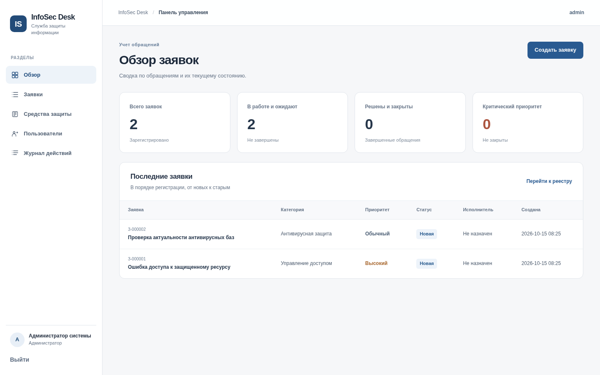

# InfoSec Desk

Система регистрации и обработки заявок на обслуживание средств защиты информации.
Пользователи работают через браузер, данные сохраняются в локальной базе SQLite.



## Возможности

- Регистрация заявок и прикрепление средств защиты к обращениям
- Поиск по номеру, теме и описанию, отбор по статусу
- Работа со статусами: новая, в работе, приостановлена, решена, закрыта
- Назначение исполнителей, комментарии и история действий
- Разграничение прав по ролям: заявитель, специалист, администратор
- Учет средств защиты и экспорт реестра заявок в CSV

## Запуск на Windows и Ubuntu

Требуется Python версии 3.10 или новее. Из корня проекта выполните одну команду:

```bash
python run.py
```

При первом запуске программа создаст виртуальное окружение `.venv`, установит зависимости и
подготовит базу `instance/infosec.sqlite3`. Затем создаст пользователя `admin` со случайным
паролем **и выведет этот пароль в терминал только один раз**. Сохраните его.

Откройте `http://127.0.0.1:8000` и войдите как `admin`. При повторных запусках используйте
ту же команду. Если зависимости уже установлены, pip не вызывается.

Для первого запуска нужен интернет. При использовании SOCKS-прокси установщик
подключает поддержку SOCKS самостоятельно. Если в Ubuntu команда `python` не задана,
можно однократно установить системный пакет `python-is-python3`.

## Восстановление пароля администратора

Если первоначальный пароль утерян, остановите сервер сочетанием `Ctrl+C` и выполните:

```bash
python run.py reset-password
```

Введите новый пароль длиной от 10 символов и повторите его. После этого запустите
`python run.py` и войдите с логином `admin` и новым паролем. База, заявки и пользователи
не удаляются. Для другого администратора используйте
`python run.py reset-password --username ЛОГИН`.

Команда предназначена для локального обслуживания компьютера владельцем файлов проекта.
Не предоставляйте другим пользователям доступ к каталогу с базой данных.

## Тестовые данные

Основная база создается пустой. Для демонстрации предусмотрена отдельная база:

```bash
python run.py seed-demo --db instance/demo.sqlite3
python run.py serve --db instance/demo.sqlite3
```

Учетные записи демоверсии:

| Логин | Пароль | Роль |
|---|---|---|
| `admin` | `DemoPass123!` | Администратор |
| `operator` | `DemoPass123!` | Специалист |
| `employee` | `DemoPass123!` | Заявитель |

**Эти пароли работают только в демонстрационной базе.** Не публикуйте демоверсию
в интернете. Вернуться к основной базе: остановите сервер и выполните `python run.py`.

## Команды

| Команда | Назначение |
|---|---|
| `python run.py` | Обычный запуск на `127.0.0.1:8000` |
| `python run.py init-db` | Создание структуры пустой базы |
| `python run.py create-admin` | Создание дополнительного администратора |
| `python run.py reset-password` | Смена пароля существующего администратора |
| `python run.py seed-demo --db instance/demo.sqlite3` | Демонстрационная база и записи |

## Проверка проекта

```bash
python -m pip install -e ".[dev]"
python -m pytest -q
python -m ruff check src tests run.py
```

Проверки автоматически выполняются в GitHub Actions на Windows и Ubuntu.

## Структура

- `run.py` - единая точка запуска
- `src/infosec_desk/db.py` - схема SQLite и транзакции
- `src/infosec_desk/service.py` - бизнес-операции и правила переходов статусов
- `src/infosec_desk/web.py` - HTTP-маршруты, сессии, проверка прав
- `src/infosec_desk/security.py` - хеширование паролей и CSRF-токены
- `src/infosec_desk/templates` - HTML-шаблоны
- `src/infosec_desk/static` - стили и иконка
- `tests` - автоматизированные тесты
- `sql/schema.sql` - определения таблиц и связей
- `docs` - архитектура, руководство, инструкции, диаграммы
- `report` - отчет по преддипломной практике

## Ограничения и эксплуатация

Это функциональный локальный прототип, а не готовый сервис для размещения в публичной сети.
Подключения к домену, корпоративной почте и оборудованию защиты не реализованы.
Перед развертыванием в организации нужны HTTPS, постоянный `INFOSEC_SECRET_KEY`,
резервное копирование базы, ограничения сетевого доступа, журналирование системных
ошибок и согласование порядка обработки персональных данных.

Для резервного копирования остановленной системы скопируйте файл
`instance/infosec.sqlite3`. При работающем сервере используйте SQLite Backup API.
